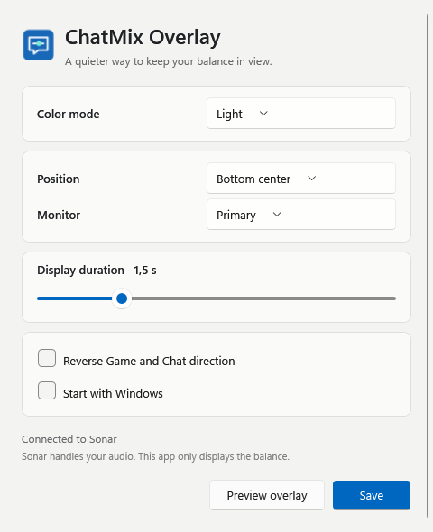

# ChatMix Overlay

A small Windows 11 overlay for the ChatMix wheel on your SteelSeries headset.

Turn the wheel and see your Game/Chat balance on screen. Stop adjusting it and the overlay disappears. SteelSeries GG and Sonar keep handling your audio as usual.


## Download and run

1. Open the [latest release](https://github.com/08Robfin/ChatMixOverlay/releases/latest).
2. Download **ChatMixOverlay-1.0.2-win-x64.zip**. The files named “Source code” are for developers.
3. Right-click the downloaded ZIP, choose **Extract All**, and put the folder somewhere you want to keep it.
4. Open **ChatMixOverlay.exe**. Its blue speech-bubble icon will appear in the system tray beside the clock. Check the hidden-icons arrow if you don't see it.
5. Keep SteelSeries GG and Sonar running, then turn your ChatMix wheel.

There is no installer, and you don't need to install .NET separately. The app is unsigned, so Windows may show an unrecognized-app warning. Only run a copy you trust.

**Requirements:** Windows 11 on an x64 PC, SteelSeries GG with Sonar enabled, and a headset/setup that reports ChatMix to Sonar. Physical wheel detection has been tested with an Arctis Nova 7; other headset models haven't been verified.

After the first launch, search for **ChatMix Overlay** from Start to open Settings. The app creates one Start menu shortcut and updates its target if the executable moves; it does not add a new shortcut on every launch.

## Using the app

- **Left-click the tray icon** to open Settings.
- **Right-click the tray icon** for Settings, Preview overlay, diagnostics, or Exit.
- **Turn the ChatMix wheel** slightly to show the balance. Tiny fluctuations are ignored to reduce accidental popups from head movement. Small adjustments appear after settling for about 0.8 seconds; larger turns appear immediately. Game is on the left; Chat is on the right. The middle mark means equal balance.
- **Stop adjusting** and the overlay fades away after 1.5 seconds by default.

The overlay is click-through and doesn't take keyboard focus. It shows the balance without percentages or numbers. It also checks Sonar's software balance, so changes through Sonar can appear too, if that control is available in your current headset mode.

## Settings

| Setting | What it does |
| --- | --- |
| Color mode | Light, Dark, or Follow Windows. Light uses a soft off-white background. |
| Position | Bottom center, top center, or bottom right. |
| Monitor | Your primary monitor, a specific monitor, or the monitor containing your mouse pointer. |
| Display duration | How long the overlay stays visible after an adjustment. |
| Reverse direction | Swap the direction if the indicator moves opposite to your headset. |
| Start with Windows | Start the app automatically when you sign in. Applies immediately; off by default. |

Use **Preview overlay** to see an example, then **Save** to keep your settings. Preview uses simulated values and doesn't change your audio.



## What it changes

ChatMix Overlay reads the balance from Sonar. It doesn't route audio, adjust volumes, install audio drivers, create virtual audio devices, or replace SteelSeries GG.

Your preferences and local diagnostics are stored in:

```text
%LOCALAPPDATA%\ChatMixOverlay
```

Enabling Start with Windows immediately creates one shortcut in the Windows Startup folder (`shell:startup`), so Windows can list it under Startup apps in Settings or Task Manager. Reopen that list if it was already open. Windows can disable this entry separately; the app does not override a Windows-level disable. When launched from a new location, the app updates its existing shortcuts. The old Run registry entry is migrated rather than registering both startup mechanisms.

## Troubleshooting

**Nothing appears when I turn the wheel**

Check that the app's tray icon is present and that GG and Sonar are running. Confirm that your wheel changes the balance in Sonar. Try **Preview overlay** from the tray menu to check the display independently of your headset. The app reconnects automatically if GG restarts.

**The indicator moves the wrong way**

Enable **Reverse Game and Chat direction** in Settings.

**The overlay doesn't appear over a game**

Try borderless windowed mode. Exclusive fullscreen and games that block external windows may hide it. Behavior varies by game; it hasn't been tested with every title.

**I want to remove the app**

Disable Start with Windows, choose **Exit** from the tray menu, then delete the extracted folder. Delete ChatMix Overlay from the Start menu as well: right-click its search result and choose Open file location to find the shortcut. You can also delete the settings folder shown above if you want to remove preferences and logs.

For a bug report, include your headset model, Windows/GG version, and relevant lines from **Open diagnostics folder**. Review the log before sharing it.

## Memory use

Version 1.0.1 stops compressing the .NET libraries inside the executable. Version 1.0.0 expanded those libraries into RAM. The download ZIP is still compressed, but the extracted executable is larger (about 162 MiB).

A short development-machine sample measured about **21 MiB private memory before opening Settings**, and **91 MiB with Settings open**. The compressed build reached about 180 MiB after opening Settings. Showing the overlay and opening Settings load additional Windows UI resources, so actual usage varies. These are private-memory samples, not a promise about the working-set number in Task Manager.

## For developers

Built with C# and WPF. Requires Windows and the .NET 9 SDK to build from source:

```powershell
dotnet build src/ChatMixOverlay.csproj -c Release
pwsh -File tools/Publish.ps1
```

The publish script creates a self-contained x64 executable, a versioned ZIP, and a SHA-256 checksum in `dist`. Run the packaged parser checks with:

```powershell
Start-Process ./dist/portable/ChatMixOverlay.exe -ArgumentList '--self-test' -Wait
Get-Content ./dist/portable/self-test.txt
```

See [technical notes](docs/technical-notes.md) for Sonar discovery, the read-only API, hardware verification, performance observations, and limitations. `tools/Observe-ChatMix.ps1` is an optional read-only diagnostic tool for PowerShell 7.

This is an unofficial project and is not affiliated with SteelSeries or Microsoft.
